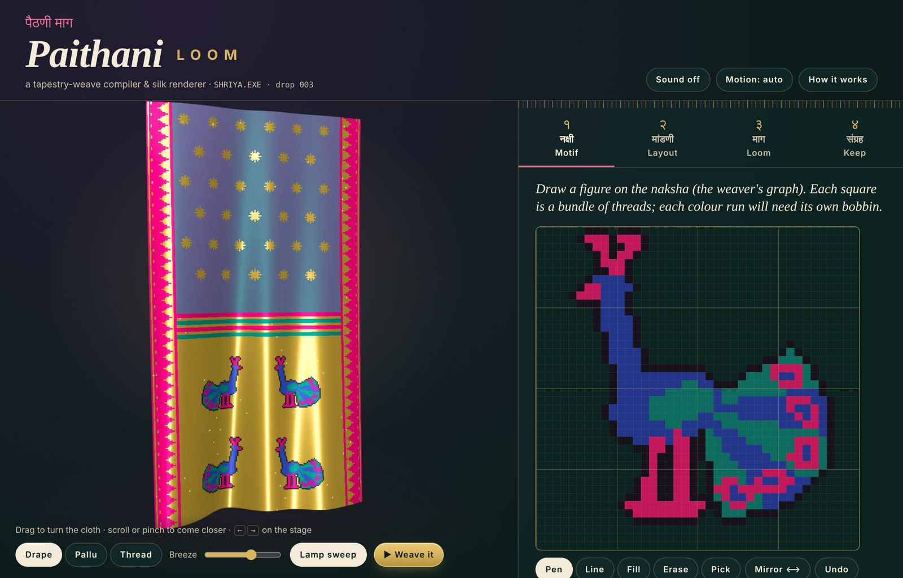
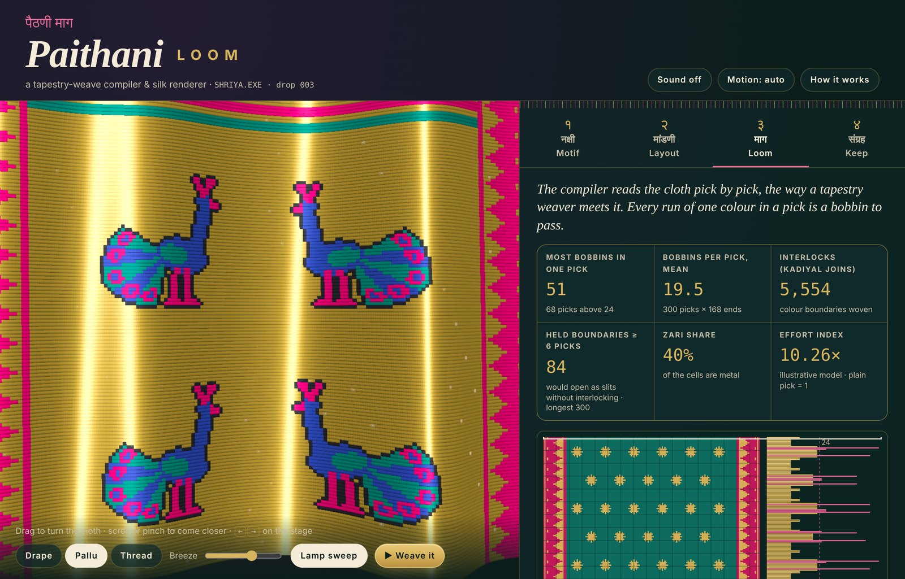
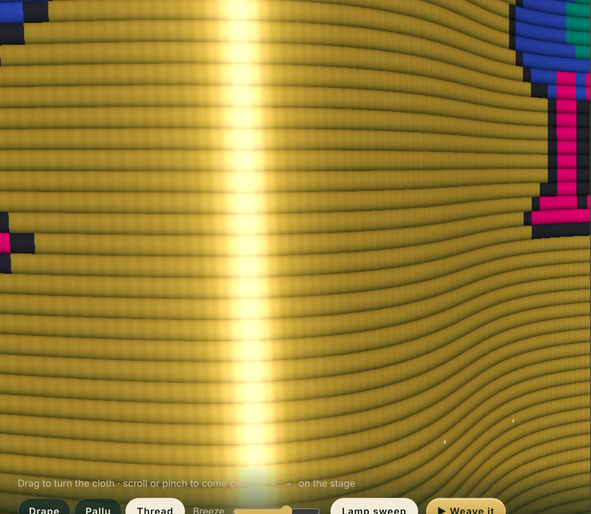
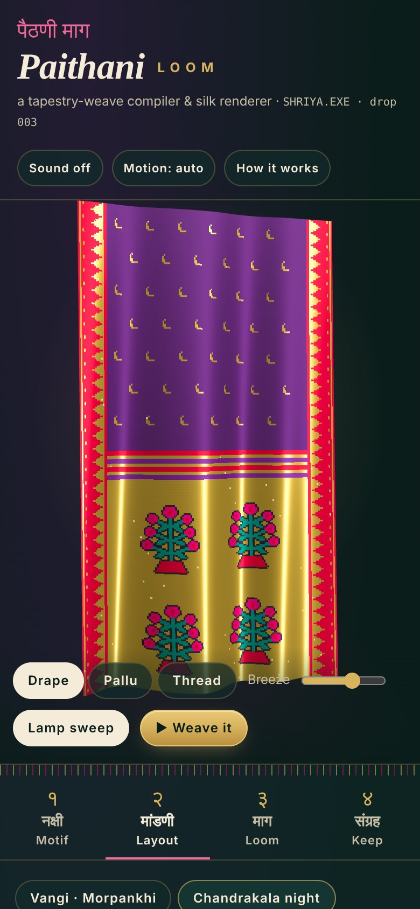

# PAITHANI LOOM · पैठणी माग

**A tapestry-weave compiler and WebGL silk renderer for Paithani-inspired textiles.** Draw a motif on the weaver's graph, compose a sari's pallu end, and the app reads the cloth pick by pick: how many bobbins each row needs, where wefts must interlock, and how much effort the design asks of a hand. Then it renders the cloth thread by thread, so shot silk changes colour as the lamp moves.

SHRIYA.EXE · drop #003 · **Live demo → https://shriyashekatkar25-byte.github.io/paithani-loom/**



| Pallu close-up and loom ledger | Thread macro | Phone |
|---|---|---|
|  |  |  |

## Why

Paithani figures are woven in **tapestry**: a figure's colour is the weft itself, laid in by hand, with a separate small bobbin for each patch of colour in a row. Where colours meet, weavers can interlock the wefts (*kadiyal*), so the back is almost as clean as the front. That makes every design a counting problem. Design tools usually show what a pattern looks like. This one also shows what it costs to weave.

## What it does

1. **Naksha (motif atelier).** A 40×40 graph-paper editor with pen, line, flood fill, erase, eyedropper, bilateral mirror, undo and full keyboard control. It starts from a library of original procedural figures named after traditional motifs: *mor* (peacock), *popat* (parrot), *kamal* (lotus), *asavali* (flowering vine), *bangdi mor*, *rui phool*, *chandrakor*, *tara*. Your figure can be woven into the pallu.
2. **Mandani (layout).** Body warp and weft colours (different colours give *dhoop-chhaon* shot silk), half-drop buttis, kadiyal borders with narali teeth, a barwa stripe band, and a zari-ground pallu with 1–3 rows of figures, optionally in facing pairs. Four presets and a seeded "Surprise me".
3. **Maag (loom compiler).** Run-length encodes every pick. It reports the most bobbins in any one pick, the mean, the interlock count, boundaries held at the same end for 6 or more picks (where a simple split tapestry would open slits), single-end runs, zari share and an illustrative effort index. There is a loom chart (graph paper + bobbins-per-pick bars) with a per-pick ledger you can step through with the keyboard.
4. **Loomability optimiser.** Merges colour runs where the eye will barely notice. Each pick is solved **exactly** as a 1-D Potts problem by dynamic programming: CIELAB ΔE fidelity, plus λ per extra bobbin, plus μ for vertical coherence. Borders are never touched. On the Pophali · Rani preset, λ = 60 and μ = 12 cut interior runs by about 21% (2,004 → 1,580 in the QA run).
5. **Silk renderer (WebGL2).** A hanging cloth with analytic folds, a lens zoom from drape to single threads, plain-weave interlacement per cell, Kajiya–Kay anisotropic highlights per thread direction, metal-tinted zari with sparse glints, analytic LOD against moiré, adaptive resolution and **weaving playback**: the cloth is woven pick by pick over bare warp, with optional synthesised loom sounds.
6. **Keep.** A local library (localStorage, validated on read), autosave of the working design, and exports: render PNG, naksha SVG (one rect per weft run), ledger CSV, full draft JSON.

## Run it

```bash
npm install
npm run dev     # local dev server
npm test        # Vitest unit tests
npm run build   # type-check + production build into docs/
```

## Architecture (summary)

TypeScript + Vite, no UI framework, no runtime dependencies. The textile model is plain, DOM-free, tested code; the UI only renders derived state.

```
src/
  main.ts            state → compose → (optimise) → compile → render; all wiring
  lib/  palette · color (Lab, ΔE, WCAG) · grid · motifs (implicit shapes)
        layout (sari composer) · weave (compiler/ledger) · optimize (Potts DP)
        storage · exporters · rng
  gl/   shaders (GLSL ES 3.00) · renderer (WebGL2, camera, adaptive quality)
  ui/   editor (naksha) · chart (loom chart) · sound (Web Audio)
  styles/main.css
tests/  Vitest suites
```

Details: [docs/ARCHITECTURE.md](docs/ARCHITECTURE.md) · art direction: [docs/DESIGN.md](docs/DESIGN.md) · product thinking: [CASE_STUDY.md](CASE_STUDY.md).

## Tech stack

TypeScript 5 · Vite 5 · WebGL2 / GLSL ES 3.00 (integer textures, analytic normals, anisotropic shading) · Canvas 2D · Web Audio · localStorage · Vitest + jsdom · Python Playwright. Fonts: Cormorant Garamond, Syne, JetBrains Mono, Rozha One, Martel (Google Fonts).

## Testing status

These results come from the build that is published here:

- `npx tsc --noEmit`: no errors.
- `npm test`: **29 tests passed in 5 files**: grid (4), motifs (4), sari composer + weave compiler (8), optimiser (4), storage + colour tokens (9). Among them: the DP matches brute force on 40 random rows; λ = 0 is the identity; the optimiser never alters borders; symmetric motifs are exactly mirror-symmetric at 4 sizes; corrupted storage is repaired; all UI text colour pairs pass WCAG AA.
- `npm run build`: succeeded (JS 53 kB, 21 kB gzipped; CSS 13 kB).
- **Python Playwright** (headless Chromium, SwiftShader WebGL) against the built `docs/` at 1280×860 and 375×812: **31 of 31 scripted checks passed**. The checks cover the WebGL renderer being active, editing/undo/keyboard tools, weaving a custom motif into the pallu, presets, sliders, swatches, figure selection, the ledger tiles and keyboard pick selection, the optimiser reducing runs, save/load/two-step delete, all four exports downloading, persistence across reload, weaving playback, the reduced-motion toggle and OS setting, no horizontal scroll on any tab at 375px, and no page errors.
- Console: no app errors. The sandbox could not reach Google Fonts, so font requests failed there and system fallbacks were used.

Not tested: real phones and GPUs, Safari/Firefox, screen readers end-to-end.

## Credits

Visual research references, and what was taken from each, are in [CREDITS.md](CREDITS.md). All motifs, shaders, sounds and code are original. Colour names follow the traditional Paithani vocabulary; the shades are this project's interpretation.

---

Original work by Shriya Shekatkar · SHRIYA.EXE · Synthetic or demo data is labeled as such. Not affiliated with any film, studio or company. · Studio gallery: https://shriyashekatkar25-byte.github.io/shriya-exe/
